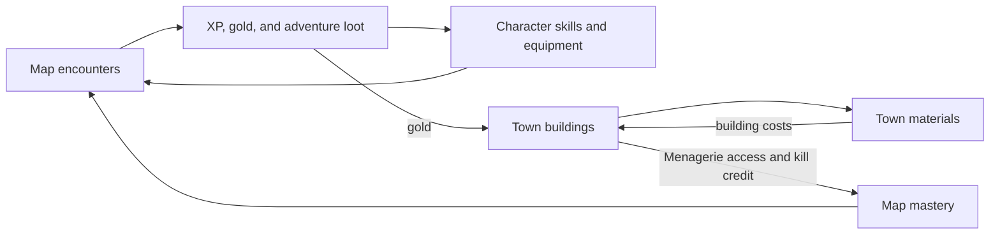

# Game overview

## Summary

Idle Adventure's first shared overview, based on working-code snapshots captured
on 2026-11-06. This is a description of the implemented structure from static
inspection. The owner's working Town direction is recorded in
[[wiki/Design/Town-Design-Intent]]; broader pacing and future direction remain open.
Start here, then read [[wiki/Foundations/Game-Glossary|the glossary]]
and [[wiki/Foundations/System-Map|the system map]] for the area being changed.

## Supported facts

### Main gameplay structure

Worlds organize ordered maps. Maps reference monster definitions through spawn
entries; an active encounter has separate live monster state. Defeating a monster
awards gold and XP, updates kill/mastery progress, and rolls material/equipment
drops. The item catalogue also supplies recipes for acquiring equipment.
Evidence: [[raw/2026-11-06/batch-03/js/world-content.js|World content]], lines
3-23, 334-356, 1035-1066; [[raw/2026-11-06/batch-03/js/game.js|Game code]],
lines 1-45, 124-160, functions `createMonsterStates` (701), `awardExperience`
(3663), and `defeatEnemy` (3672-3715).

The following diagram is a synthesis of those dependencies and the documented
progression rules. Arrows show contributions, not a required order of play.

Skill-point caps and map mastery are separate progress systems; Menagerie
credit does not multiply XP, gold, or drop rewards. See
[[wiki/Systems/Progression/World-Progression-and-Mastery|world progression and mastery]] and its
[[raw/2026-11-06/batch-02/SAVE_COMPATIBILITY.md#Content edits|Menagerie evidence]].

### Town's place in the current implementation

Town has its own buildings and material balances, sharing the character's gold.
Production uses the simulation clock and runs across owned buildings, rather
than being driven by the Town screen's animation. The Menagerie connects Town
progress to map mastery. The owner wants Town to offer optional acceleration
and meaningful investment choices; specific mechanisms remain undecided.
Design evidence: [[raw/2026-11-06/batch-03/town-design-intent.txt|Owner note]],
paragraphs 1-4. [[wiki/Design/Town-Design-Intent]] separates that direction from the
current implementation.
Evidence: [[raw/2026-11-06/batch-03/js/resources.js|Spending]], lines 6-15;
[[raw/2026-11-06/batch-03/js/town-progression.js|Town rules]], `tick` (105-129)
and `masteryUnlocked` / `killCredit` (131-149);
[[raw/2026-11-06/batch-03/js/combat-simulation.js|Simulation]], lines 7-9;
[[raw/2026-11-06/batch-03/js/game.js|Host wiring]], lines 4360-4365.

### Player-facing pages

The main navigation names are Town, Map, Crafting, Skill Tree, and Inventory.
Crafting's historical `townButton` ID must not be confused with the current
Town page. Evidence: [[raw/2026-11-06/batch-03/index.html|Entry page]], lines 41-44.

## Connections

- [[wiki/Foundations/Game-Glossary]] gives terms, internal IDs, and naming ambiguities.
- [[wiki/Foundations/System-Map]] identifies the files and boundaries to inspect for a change.
- [[wiki/Systems/Town/Town-System]] is the first detailed system guide.
- [[wiki/Design/Town-Design-Intent]] records owner goals and undecided possibilities.
- [[wiki/Design/Equipment-Design-Intent]] records the intended mix of finding items
  and improving rolls, with better stats or a build-changing unique effect as
  reasons to replace a weapon. Evidence:
  [[raw/2026-11-06/batch-05/equipment-design-intent.txt|Owner direction]], line 1.
- [[wiki/Systems/Saves/Save-Compatibility]] describes preservation and migration rules.
- [[wiki/Systems/Equipment/Equipment-Crafting|Anvil]] covers equipment rerolling, distinct from
  Crafting (item creation). The W2 Ore-to-Bars building is Smeltery, per the
  owner's [[raw/2026-11-06/batch-04/town-smeltery-naming.txt|naming revision]].

## Storage and maintenance

Preserve input evidence in `raw/`: code snapshots, original documents, and
verbatim owner design notes. Maintain the organized definitions and synthesis
in `wiki/`. The live game files stay in the project. New versions get new raw
paths, then affected notes and the source inventory are updated according to
[[instructions/AGENT|the vault rules]]. The graph comes from links in wiki notes.

## Open questions

- Which Town-exclusive unlocks fit the owner's optional-progression direction?
- What are the intended progression pace and balance targets?
- Which existing names should be kept or changed as the game's vocabulary?

New design proposals belong in a clearly labeled proposal until the owner
decides them. Static code inspection does not establish those decisions.
